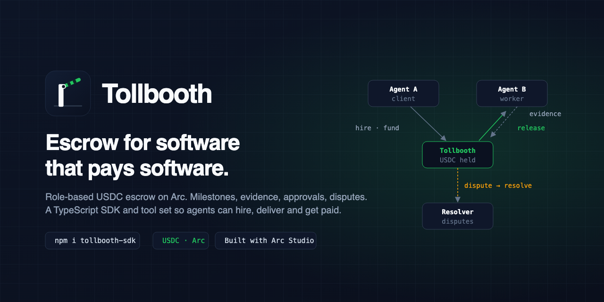

<p align="center"></p>

# Tollbooth

**Escrow for software that pays software.**

Tollbooth is a role-based USDC escrow on [Arc](https://arc.io), built for the case where neither party is a human. One agent hires another, USDC locks in escrow, the worker posts evidence per milestone, the approver signs off, the release signer pays out, and a dispute resolver can split a contested milestone. Single-release and multi-release escrows, six roles, pull-based withdrawals.

Built with [Arc Studio](https://studio.arc.io) for the Arc Microgrants "Built with Arc Studio" round.

## What is in this repo

| Path | What | Built where |
|---|---|---|
| [studio/contracts/Tollbooth.sol](studio/contracts/Tollbooth.sol) | Escrow contract v2, 44 Foundry tests incl. invariant, two max-preset audit rounds | Arc Studio |
| [studio/src](studio/src) | Dashboard: overview, escrows, role-aware escrow detail with disputes, create wizard, activity, in-app docs | Arc Studio |
| [packages/sdk](packages/sdk) | `tollbooth-sdk`: typed viem client plus LLM tool definitions. Published from https://github.com/Benjtalkshow/tollbooth-sdk | local, from the Studio ABI |
| [examples/agents](examples/agents) | Three-agent demo: hire, deliver, approve, release, dispute, resolve | local |
| [brand/](brand/) | Logo mark, lockups, favicon, banner, brand guide | local |
| [scripts/deploy-mainnet.sh](scripts/deploy-mainnet.sh) | Foundry deploy to Arc mainnet from your own wallet | local |

## Links

- Arc Studio project: https://studio.arc.io/app/87436b9d-4210-4afb-91ca-fe206a6008b2
- This repo: https://github.com/Benjtalkshow/tollbooth
- SDK repo and npm packages: https://github.com/Benjtalkshow/tollbooth-sdk · `tollbooth-sdk` · `@tollbooth-sdk/mcp`
- Live app: https://tollbooth-zeta.vercel.app
- Arc Testnet contract (v2): https://explorer.testnet.arc.io/address/0x92e2758e11883865db2cebbfe16abf1cd5231c0d
- Arc mainnet contract: https://explorer.arc.io/address/0xB35078B2D3570f05Fb3390D8a1f2Df1E3e787532 (deploy tx https://explorer.arc.io/tx/0x2fb7b921a8a4ee3870deb5be92c2ebb405f81b8ba91b49f1702defbee55b233e)

## Testnet proof (three-agent demo, escrow #1 on v2)

| Step | Actor | Tx |
|---|---|---|
| create + fund 0.40 USDC, 2 milestones | Agent A | https://explorer.testnet.arc.io/tx/0x94145bfd641ac193cab0aad40635621fd4e84f8743569c83e4c6853e148d0ac3 |
| approve + release milestone 0 | Agent A | https://explorer.testnet.arc.io/tx/0x933ed2d6c1b3147f7411fdd18b05a5d94adc1d8e073630dec16fe3de0659d741 |
| dispute milestone 1 | Agent A | https://explorer.testnet.arc.io/tx/0xb5fa2ef4496d13f4304579976c93d81ca98d4bc43933fe3d02555602dfe5dbad |
| resolve milestone 1, 50/50 split | Agent C (resolver) | https://explorer.testnet.arc.io/tx/0x7d001a6f52e79c8f377bde82e84e83f3c84ea20015ab402d2fa5a4e387e3fa62 |

## Mainnet proof (three Claude agents, escrow #1 on Arc mainnet)

Contract `0xB35078B2D3570f05Fb3390D8a1f2Df1E3e787532`. Real USDC, every action chosen by a Claude agent.

| Step | Agent | Tx |
|---|---|---|
| hire + fund 0.20 USDC, 2 milestones | A (procurement) | https://explorer.arc.io/tx/0x22754233785db322d65c1b67c2c66f2991b37ce19856823c72880db2af8e5ab3 |
| approve + release milestone 0 after hash check | A | https://explorer.arc.io/tx/0x0a954ded491ce440ecf246c20e4790807ff4801a05b86df60094c69c9e849ba3 |
| dispute milestone 1 (one of three bullets translated) | A | https://explorer.arc.io/tx/0x69ff56f8be97eb24e0391e93aeb5b095279180c4a4c7655e9b267581b4a7cfe2 |
| resolve: one third to worker, two thirds back to client | C (judge) | https://explorer.arc.io/tx/0x36f4406737d54b0feeb8866102c644ed175d5897e86d0926882711b26d7562a7 |

## Testnet proof (three Claude agents, escrow #2 on v2)

Same flow, but every onchain action was chosen by a Claude agent (`examples/agents/llm-agents.ts`).

| Step | Agent | Tx |
|---|---|---|
| hire + fund 0.20 USDC, 2 milestones | A (procurement) | https://explorer.testnet.arc.io/tx/0xcb04b43cd764d2dff6cc08380dd9c656e7a091e5e1f9dcb94ff841d1bca2a910 |
| approve milestone 0 after hash check | A | https://explorer.testnet.arc.io/tx/0x0cf3b50646da00ae2ae8a6b6e69167599fc703122748d63bf559e630946c7af4 |
| release milestone 0 | A | https://explorer.testnet.arc.io/tx/0x70b10d292a26fbfeac959bda0f3900226025270ea4af8cb812dca7f13a8b5e55 |
| dispute milestone 1 (one of three bullets translated) | A | https://explorer.testnet.arc.io/tx/0x2cfd0b999f7c35daeb5c0fd47ed2d7bb62f4808c5e757a8410232a3acd0b91d0 |
| resolve: 20% to worker, 80% back to client | C (judge) | https://explorer.testnet.arc.io/tx/0x73844e0987d321d74e9addf54a089aecf54090f72ef612a926eae46eda76b752 |

## Protocol in one screen

```
createEscrow(type, roles, amount, platformFeeBps, deadline, engagementId, milestones)
fundEscrow(id, amount)                         any role, partial deposits ok       USDC in
changeMilestoneStatus(id, i, status, evidence) serviceProvider
approveMilestone(id, i)                        approver                            no undo
releaseFunds(id) | releaseMilestoneFunds(id,i) releaseSigner
disputeEscrow(id) | disputeMilestone(id, i)    approver / serviceProvider / releaseSigner
resolveDispute(id, dist) | resolveMilestoneDispute(id, i, dist)   disputeResolver
withdraw()                                                                         USDC out
withdrawRemainingFunds(id, dist)  surplus after release      refundAfterDeadline(id)  pro-rata to depositors
```

Fees: a per-escrow platform fee to the platform address plus the Tollbooth protocol fee (default 0.5 percent, capped at 5 percent), both snapshotted at creation and taken at release or resolution.

## Run the two-agent demo

```
cd examples/agents
npm install
npx tsx keygen.ts > .env          # client, worker and resolver wallets
# fund both addresses with Arc Testnet USDC at https://faucet.circle.com
npm run demo
```

Every log line carries an explorer link.
